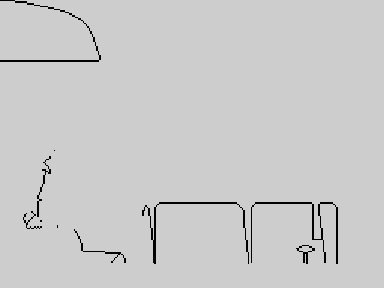
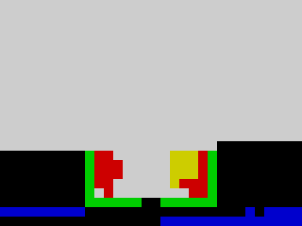

# Mugsy (ZX Spectrum, 1984): an annotated disassembly

A complete, fully commented disassembly of **Mugsy**, the comic-strip gangster strategy game published by Melbourne House for the 48K ZX Spectrum in 1984, built with [SkoolKit](https://skoolkit.ca/) 10.2.

 

You are Mugsy, boss of a 1920s protection racket. Each year your sidekick Louey reports in speech bubbles over full-screen pictures, and you decide how many clients to buy, sell and squeeze, how much to spend on artillery and ammo, how much to pay the cops, and whether to pay off rival mobs or your own hoods. Blunder too often and the hit man from Detroit comes for you in an arcade shootout.

## What's here

- **Every routine and data block titled and described**: 356 blocks, with a comment on every instruction (about 95% written by hand).
- **The game's bytecode decoded.** Almost all the game logic runs on a small virtual machine with 35 instructions and 84 fixed-point variables. All 721 instructions of the script are decoded, named and linked.
- **Louey's text decoded.** There are 118 messages and 12 rating words, compressed with a 225-word dictionary, single-byte tokens for the 32 commonest words, random choices and back-references.
- **The economics in full**: the yearly model step by step, the scoring formula, and the best strategy found by optimising over hundreds of thousands of simulated games.
- **12 bugs in the original**, each confirmed on a Z80 simulator or traced in the script. These include a game that almost never ends on time, an ammo question where every answer counts as a blunder, square roots that freeze the machine, and a client purchase that can overflow and pay you millions.
- **15 pieces of trivia**, such as leftover assembler source in memory, self-modifying music, a shootout that is a tiny multitasking system, and the uneven odds behind the random animations and backgrounds.
- **A comparison with The Hobbit** (Melbourne House, 1982). Mugsy's picture engine is a modified copy of The Hobbit's, and all 22 of The Hobbit's pictures draw pixel for pixel identically in Mugsy's engine.

The source rebuilds byte for byte to the original 40,960 bytes of code and data (addresses 24576-65535), both with SkoolKit's `skool2bin.py` and with an unmodified copy of sjasmplus.

## Reading it

Open `html/mugsy/index.html` in a browser. The front page links to every section:

| Page | Contents |
|---|---|
| Overview | What the game is, how the program is laid out, and a memory map |
| Economics | The yearly model, what each answer really does, the score, and the best strategy |
| The VM / VM variables | The bytecode instruction set and all 84 variables |
| Pictures | All nine pictures, the shootout sprites, the font and three recorded animations |
| Mugsy and The Hobbit | The routine-by-routine comparison of the picture engines |
| Bugs / Trivia | The 12 bugs and 15 trivia entries |
| Routines, Data, Messages | The disassembly itself |

The `html` folder is self-contained, so it can also be published as it is, for example with GitHub Pages.

## Building

You need [SkoolKit](https://skoolkit.ca/) 10 (tested with 10.2).

```sh
skool2html.py -d html mugsy.skool    # HTML disassembly (reads mugsy.ref automatically)
skool2asm.py mugsy.skool > mugsy.asm # assembler listing
skool2bin.py mugsy.skool mugsy.bin   # rebuild the original 40,960 bytes
```

The rebuilt `mugsy.bin` should have the MD5 checksum `a7438c94d92e7c9f13bb89e4cb88c0f9`. The listing also assembles to the same bytes with sjasmplus 1.24.1:

```sh
sjasmplus --raw=out.bin mugsy.asm
```

## Repository layout

| Path | Contents |
|---|---|
| `mugsy.skool` | The annotated disassembly (SkoolKit source) |
| `mugsy.ref` | The hand-written pages: Overview, Economics, VM, Variables, Pictures, Hobbit, Bugs and Trivia |
| `mugsy.ctl` | Control file generated from the skool file |
| `mugsy.asm` | Assembler listing generated from the skool file |
| `vm-script.txt` | The game's bytecode scripts as plain text, one instruction per line |
| `html/` | The built HTML disassembly |
| `images/` | Pictures and animations used by the HTML, all produced by running the game's own code |
| `screenshots/` | Simulator screenshots |
| `analysis/` | Results of the strategy optimisation and sensitivity runs |
| `theme/` | Stylesheet and navigation script for the HTML |
| `tools/` | The Python tools used to build and analyse the disassembly |

## The tools

`tools/package.sh` regenerates everything from the tools. It rebuilds `mugsy.skool`, the HTML, the listing and the control file, checks that the rebuild is byte-identical, and makes a zip. The main pieces are:

- `build.py`, `notes*.py`, `data_notes.py` and `mugsylib.py`: generate `mugsy.skool`. They hold the text decoder, the VM disassembler and the hand-written comments.
- `linkify.py`: turns addresses in descriptions and comments into links.
- `vmscript.py`: writes `vm-script.txt`.
- `pyvm.py`: an exact reimplementation of the game's VM, validated against the Z80 code.
- `policy.py`, `optimise.py`, `refine.py`, `sensitivity.py`, `longrun.py`: the strategy search behind the Economics page.
- `sim.py`, `capture.py`, `shoot.py`, `pics.py`, `anim.py`, `shootgif.py`, `overflow.py`, `numentry.py` and others: harnesses that run the game's own routines in SkoolKit's Z80 simulator to confirm bugs, render pictures and record animations.
- `hobbit_*.py`: the comparisons on the Hobbit page.

Most of the analysis tools need things that aren't in this repository. They need a memory image of the loaded game (`work/mem.bin`, taken from the tape's code block), and the Hobbit tools need an assembled disassembly of The Hobbit. They also expect the project at a fixed path, set near the top of each script. None of this is needed to build or read the disassembly.

## How it was made

The code was separated from the data by running the game in SkoolKit's Z80 simulator with scripted keypresses over many games, recording every executed address, and then following every branch statically from those addresses. The VM scripts were traced from the nine places that start the interpreter. The messages were decoded with a Python reimplementation of the text renderer. Claims on the Bugs, Trivia and Economics pages were checked against the code, either by running the real routines in the simulator or by tracing the script.

## Copyright

Mugsy is © 1984 Melbourne House. This disassembly is an independent study of the game for documentation and preservation, and is not affiliated with or endorsed by the copyright holders. The tape image is not included.
